# BeefTV 系统技术设计文档（impl_tech.md）

> 版本：v1.0 ｜ 编写日期：2026-11-01 ｜ 基于分支：main（f4dd5b5d）
> 目标市场：菲律宾、泰国 ｜ 部署目标：阿里云 ACK（含单机 Docker Compose 形态）｜ 整体 SLA 目标：99.95%
>
> 本文档分为两大部分：**现状事实**（均可回溯到代码/配置，附文件路径）与**目标设计**（面向东南亚云上部署的改造与运维方案）。所有"目标设计"内容在落地前需按第 9 章改进路线逐项实施，不代表当前代码已具备。

---

## 目录

1. [系统概述与设计约束](#1-系统概述与设计约束)
2. [整体分层架构设计](#2-整体分层架构设计)
3. [代码目录结构设计](#3-代码目录结构设计)
4. [数据存储结构设计](#4-数据存储结构设计)
5. [核心业务时序图](#5-核心业务时序图)
6. [日志、监控、限流、灰度与回滚](#6-日志监控限流灰度与回滚)
7. [部署方案（ACK + Docker Compose）](#7-部署方案ack--docker-compose)
8. [SLA 99.95% 达成设计](#8-sla-9995-达成设计)
9. [系统不足与改进措施](#9-系统不足与改进措施)
10. [GitOps 三环境流水线](#10-gitops-三环境流水线)
11. [附录：环境变量与容量参数速查](#11-附录环境变量与容量参数速查)

---

## 1. 系统概述与设计约束

### 1.1 产品定位

BeefTV 是面向 AI 影视与短剧创作的工作台，核心能力：

- **无限画布**：节点式编排图片/视频/音频/文本生成任务，leafer 渲染、LOD 分层、空间索引。
- **生成任务系统**：任务创建 → worker 领取 → 上游模型调用（多 Provider/Protocol 适配）→ 轮询/取回产物 → 素材入库。
- **素材与资源管理**：上传（含分片）、版本、表示（representations）、播放副本（ffmpeg H.264）、引用检查后删除。
- **短剧工作流**：项目/单元/分镜（shots）/修订/工作流实例。
- **AI 助手**：Go 管理运行时 + `agent-host/`（钉选官方 pi SDK 的 Node 宿主），经 `/api/assistant/*` 与 `/api/ops` 双向交互。
- **桌面端**：Wails v2 壳（`backend/cmd/desktop`），本文云上部署使用无头 `backend/cmd/server`。

### 1.2 现状技术栈

| 单元 | 技术栈 | 入口 |
| --- | --- | --- |
| `web/` | Vite 8(rolldown)、React 19、TS、React Router、AntD 6、Tailwind、Zustand 5、TanStack Query 5、Bun 1.3 | `web/src/application.tsx`、`web/src/router.tsx` |
| `backend/` | Go 1.25、Gin、GORM、SQLite（CGO，WAL） | `backend/cmd/server`（云）、`backend/cmd/desktop`（桌面） |
| `agent-host/` | Node ESM、@earendil-works/pi-* 1.3.0 | Go `assistantruntime` 以子进程拉起 |
| `docs/` | Next.js、Fumadocs、MDX | `docs/content/docs/` |

规模：前端 `web/src` 约 935 个 ts/tsx 文件、16.8 万行；画布相关 334 个文件；前端测试 691 个文件（bun:test）。后端 `internal/` 约 70 个领域包。

### 1.3 决定云上架构的硬约束（现状事实）

| # | 约束 | 证据 | 对部署的影响 |
| --- | --- | --- | --- |
| C1 | **数据库仅 SQLite，连接池 MaxOpen=MaxIdle=1**，写串行化 | `backend/internal/database/database.go:30,46`（DSN `_busy_timeout=5000&_journal_mode=WAL&_synchronous=NORMAL`） | 后端**不能多副本共享同一库**；水平扩展必须先外置数据库（RDS PostgreSQL） |
| C2 | **素材/产物全部落本地磁盘** `dataDir/resources` | `backend/internal/asset/file_store.go:19`；可选 S3 兼容 `referencestorage`（默认关闭） | 云上用 OSS；多副本前必须完成存储外置 |
| C3 | **server profile 无入口鉴权**（单用户本地工作区，`currentUser`=工作区 owner） | `backend/cmd/server/main.go:85`、`backend/internal/handler/local_identity.go:17` | 公网暴露前必须在网关层补鉴权（本文第 7 章方案） |
| C4 | **无 metrics/prometheus，日志为标准库 log + gin formatter → stdout** | `backend/internal/bootstrap/runtime.go:205` | 监控需外接采集（SLS + ARMS），并补 `/metrics` |
| C5 | **SSE 长连接**：文本事件 750ms 轮询读库、15s 心跳；nginx 已关缓冲，read_timeout 3600s | `backend/internal/handler/text_replay.go:66,107`、根 `nginx.conf` | ALB/Ingress 必须透传 `X-Accel-Buffering`、加大空闲超时 |
| C6 | **优雅停机最长 10 分钟**（drain → worker 等待 → 关库） | `runtime.go:432-509`、compose `stop_grace_period: 10m` | K8s `terminationGracePeriodSeconds` 需对齐（建议 660s） |
| C7 | **迁移账本 v28 不可改写**，破坏性迁移前 `VACUUM INTO data/backups/` | `backend/internal/database/local_schema.go:298,311-354` | 回滚不能靠"降级 schema"，必须 expand-contract + 备份恢复 |
| C8 | 镜像已双架构（amd64/arm64）发布 ghcr.io | `.github/workflows/publish-images.yml` | GitOps 可直接消费，同步到 ACR |
| C9 | 仓库内**无 K8s/Helm/Terraform/压测脚本** | 全仓检索 | 本文第 3/7/10 章为新增设计 |
| C10 | compose 中 `CANVAS_LOCAL_MODE`、`CANVAS_REGISTRATION_ENABLED` 在 Go 代码无读取点（死变量）；local 模式并发/配额放开到 999 | `backend/internal/platform/runtime_policy.go:174` | 生产限流/配额必须显式设计，不能依赖默认值 |

---

## 2. 整体分层架构设计

### 2.1 目标架构图（阿里云东南亚形态）

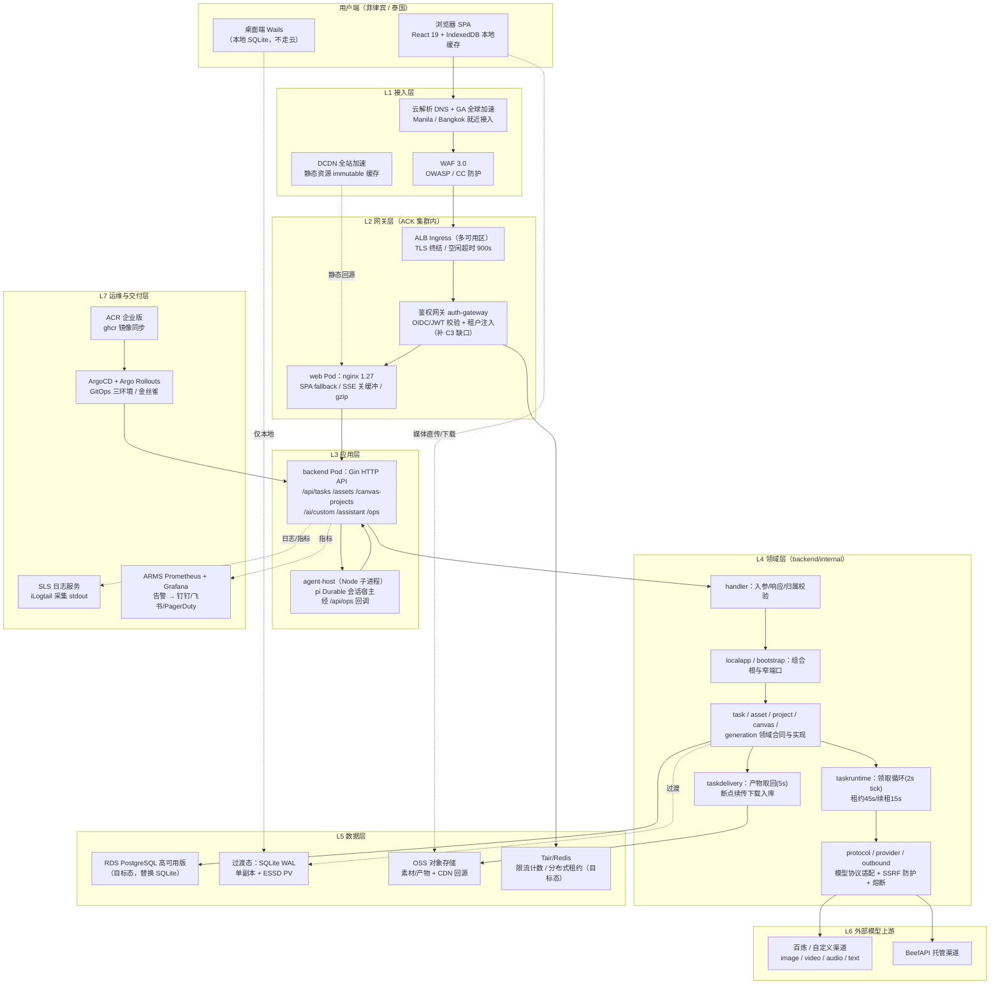

> 说明：`DT`（桌面端）保留本地 SQLite 形态不进入云架构；云上部署只针对 `cmd/server`。虚线为过渡态/旁路链路。

### 2.2 每一层的职责说明

| 层 | 职责 | 现状载体 | 云上目标载体 | SLA 关键点 |
| --- | --- | --- | --- | --- |
| **L1 接入层** | DNS 解析、就近接入、静态加速、DDoS/CC/WAF 防护、TLS | 无（本地回环） | 云解析 DNS + GA（全球加速）+ DCDN + WAF 3.0 | 菲/泰用户经 GA 边缘 POP 进入阿里云骨干网，规避公网跨境抖动；静态资源命中 DCDN 后源站故障不影响已缓存页面 |
| **L2 网关层** | 路由、TLS 终结、**鉴权与租户识别（补 C3）**、限流第一道、SSE 透传、SPA fallback | 根 `nginx.conf`（3000 端口，SSE 专用 location 已关缓冲） | ALB Ingress（多 AZ）+ auth-gateway（OIDC/JWT）+ nginx web Pod | ALB 多 AZ 实例自身高可用；SSE 路由必须 `proxy_buffering off` + 空闲超时 ≥ 900s |
| **L3 应用层** | HTTP API、任务编排入口、AI 助手宿主进程管理 | `cmd/server` 单进程 + `agent-host` 子进程 | ACK Deployment（过渡单副本 / 目标多副本） | 探针映射 `/api/health/live`、`/startup`、`/ready`；停机 drain 对齐 660s |
| **L4 领域层** | handler→localapp 端口→领域实现→repository 的严格调用方向；任务租约、状态机、协议适配、出网安全 | `backend/internal/*`（约 70 包） | 同代码，随 L3 伸缩 | worker 租约机制（45s）保证副本崩溃后任务可被重新领取，是未来多副本的基础 |
| **L5 数据层** | 结构化数据、媒体对象、缓存/计数 | SQLite 单文件 + 本地磁盘（C1/C2） | RDS PostgreSQL 高可用 + OSS + Tair | 过渡态单副本是全系统可用性短板（第 8 章量化）；目标态 RDS 跨 AZ 主备自动切换 |
| **L6 模型上游** | 第三方生成模型（图/视频/音频/文本） | `provider/`、`protocol/`、`outbound/`（SSRF 防护、重定向≤5、渠道熔断 5 次/60s） | 经 NAT 网关固定 EIP 出网（上游白名单需要） | 上游不可用不计入本系统 SLA，但需熔断+降级+任务可恢复（`recovery_outcome`） |
| **L7 运维交付层** | 日志、指标、告警、发布、回滚、备份 | stdout 日志 + 健康端点 + GitHub Actions | SLS + ARMS + ArgoCD/Rollouts + ACR + OSS 备份 | 发布走金丝雀/蓝绿，回滚以镜像 digest 为单位（第 10 章） |

### 2.3 后端内部调用方向（现状即目标，不得违反）

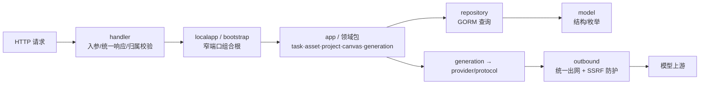

约束（来自 AGENTS.md，云上改造同样遵守）：新领域合同不得反向 import `internal/app`；handler 不放数据库查询；repository 不承载业务策略。

---

## 3. 代码目录结构设计

### 3.1 现状目录（事实）与目标增量

```text
BeefTV-yxw/
├── web/                          # 前端（Vite + React 19 + Bun）
│   ├── src/
│   │   ├── pages/                # 路由页面 + 页面私有 hooks/组件
│   │   │   ├── home/ create/ canvas/ projects/ assets/ tasks/
│   │   │   ├── agents/ skills/ plugins/(含 eagle) settings/ dev/
│   │   │   └── canvas/project.tsx        # 2967 行，画布主页面（协调流程）
│   │   ├── layouts/              # user-layout：路由壳 + 全局浮层
│   │   ├── components/           # 跨页面复用 UI（14 个子域）
│   │   │   └── canvas/           # 137 个文件：节点/连线/minimap/LOD/
│   │   │                         #   director 工作台(2222行)/leafer 图形层
│   │   ├── services/
│   │   │   ├── api/              # 50 个业务 API 模块；唯一入口 request.ts 的 http
│   │   │   │                     #   （axios 封装，信封 {code,data,msg,reason}，4s 超时快速降级）
│   │   │   │                     #   渠道协议：custom-channel-relay / channel-transport /
│   │   │   │                     #   image-protocols / video-contracts / audio
│   │   │   ├── local-workspace-repository.ts  # 1264 行，IndexedDB 离线缓存
│   │   │   ├── local-workspace-sync.ts / canvas-operation-journal.ts  # 同步/操作日志
│   │   │   ├── canvas-generation-consumer.ts  # 生成任务消费/去重/物化
│   │   │   └── resource-blob-cache.ts 等媒体缓存
│   │   ├── stores/               # Zustand：canvas/ 6 个 + 顶层 13 个
│   │   │                         #   persist → localforage（按用户 scope 排队写）
│   │   ├── lib/                  # 纯函数：canvas/ 约150文件（document/rebase/
│   │   │                         #   patch-merge/spatial-index/lod/storyboard/workflow/
│   │   │                         #   ffmpeg-session/face-detector.worker）
│   │   │                         #   generation-error.ts(1162行，错误码映射)
│   │   └── styles/globals.css    # 三层 token：Primitive→Semantic→Component
│   ├── test/                     # 691 个测试文件（bun:test，67 个 browser 级）
│   ├── scripts/                  # run-test-suite.mjs 等构建/测试编排
│   ├── vite.config.ts            # /api 代理、static 资产目录、vendor 分包、slim 摇树
│   └── eslint.config.js          # UI 退场规则（禁 antd Empty / 静态 Modal.confirm / toSorted）
│
├── backend/                      # Go 1.25 + Gin + GORM
│   ├── cmd/
│   │   ├── server/               # 无头 HTTP（云部署入口）
│   │   └── desktop/              # Wails 桌面壳（launch token/单实例锁/自动更新）
│   ├── internal/
│   │   ├── handler/              # HTTP 层：api.go 路由注册、text_replay.go SSE、
│   │   │                         #   custom_proxy.go 渠道中转、local_identity.go 身份
│   │   ├── bootstrap/ localapp/  # 组合根 runtime.go Open()；窄端口 ports.go
│   │   ├── app/                  # 跨域编排 + task_worker.go / task_delivery.go
│   │   ├── task/                 # 状态机 outcome 投影、lifecycle 重试、幂等
│   │   ├── taskruntime/          # 领取循环：2s tick、租约45s、续租15s、槽位信号量
│   │   ├── taskdelivery/         # 产物取回：5s 循环、批量≤64、断点续传
│   │   ├── asset/ project/ canvas/ generation/  # 领域合同与实现
│   │   ├── repository/           # GORM 查询（领取 SQL 条件更新等）
│   │   ├── model/                # 全部表结构 + 索引 tag
│   │   ├── database/             # 连接（WAL/MaxOpen=1）、local_schema.go 迁移账本 v28
│   │   ├── provider/ protocol/ outbound/        # 上游能力/声明式协议/统一出网+SSRF
│   │   ├── assistantruntime/ assistantturns/ agentops/  # pi 宿主进程管理与操作授权
│   │   ├── platform/             # RuntimePolicy：并发/配额/超时（local 模式放开）
│   │   ├── security/             # 进程内滑窗限流协调器
│   │   ├── diagnostics/ supporttrace/           # 诊断包、写操作 span、Trace-ID
│   │   └── ...（workspace/privatefile/localcrypto/desktopstorage 等约70包）
│   ├── Dockerfile                # 三阶段：插件包→CGO 构建→alpine 非 root 运行
│   └── Dockerfile.dev            # air 热重载
│
├── agent-host/                   # Node pi SDK 会话宿主（server.mjs/operation-bridge.mjs）
├── plugins/ plugin-packages/     # 协议插件源码与构建产物（manifest 声明式协议）
├── docs/                         # 文档站（Fumadocs）+ 架构/运维/证据文档
│   ├── content/docs/backend/     # backend-database.mdx / http-api.mdx / code-map.mdx
│   ├── architecture/             # generation-task-state.md 等状态机合同
│   └── ops/                      # 运维记录
├── scripts/                      # 发布/打包/冒烟/契约测试（约70个脚本）
├── tools/depth-capture/          # Python(uv) 深度视频工具
├── fixtures/                     # 错误码等测试 fixture
├── .github/workflows/            # 9 条流水线（quality/publish-images/release-desktop 等）
├── Dockerfile                    # 前端两阶段：bun 构建→nginx:1.27-alpine，EXPOSE 3000
├── nginx.conf                    # SSE 关缓冲/静态 immutable/SPA fallback
├── docker-compose{,.build,.dev,.local}.yml
│
│  ────────── 以下为目标设计新增（当前仓库不存在，C9） ──────────
├── deploy/                       # 部署清单（GitOps 源）
│   ├── compose/                  # 现有 compose 收敛于此（保留根软链兼容）
│   ├── k8s/
│   │   ├── base/                 # Kustomize base：backend/web/auth-gateway/ingress
│   │   └── overlays/             # dev / staging / prod 三环境差异
│   ├── helm/beeftv/              # 可选 Helm chart（与 kustomize 二选一，推荐 kustomize）
│   └── terraform/                # 阿里云 IaC：VPC/ACK/ALB/RDS/OSS/SLS/ACR
├── loadtest/                     # 压测（k6）
│   ├── scenarios/                # task-create.js / sse-fanout.js / upload.js / browse.js
│   ├── thresholds.json           # SLO 阈值（p95、错误率）
│   └── README.md                 # 压测执行手册与报告归档
└── likha/impl_tech.md            # 本文档
```

### 3.2 逻辑分层规则（前后端）

**前端**（依赖方向：pages → services/stores → lib；lib 不依赖 JSX/路由）：

- 页面协调流程，不直接拼装后端协议；业务 API 唯一入口 `http`（`web/src/services/api/request.ts`），HTTP 200 ≠ 业务成功，`code !== 0` 抛 `ApiError`，用 `reason`/`code` 判型。
- 大 JSON/媒体走带用户 scope 的 localforage（9 个 object store：`app_state`、`image_files`、`media_files`、`resource_blobs` 等）；localStorage 只存小配置与 `active-user-scope`。
- 用户切换：`lib/user-scope.ts` 的 scope+epoch 时钟隔离 React Query / localforage / 资源缓存，`assertUserScope` 拦截跨用户写。
- 降级合同：4s API 超时 → 本地 IndexedDB 缓存兜底打开项目；UI 必须区分"本地缓存成功"与"服务端持久化成功"。

**后端**：`HTTP → handler → localapp/domain port → app/domain → repository/model`；模型上游经 `generation → provider/protocol → outbound`。强校验写路径（生成/删除/上传/配额/密钥）不允许空 ID、默认用户、默认额度兜底；素材删除先查引用，物理删除失败不得删记录。

### 3.3 测试体系

| 层级 | 现状 | 命令 | 目标增量 |
| --- | --- | --- | --- |
| 前端单元/浏览器 | 691 个测试文件（bun:test），67 个 browser 级 | `cd web && bun test`、`bun run build`（含 tsc --noEmit） | 云端多用户场景的 scope 隔离回归 |
| 前端 e2e | director-e2e（Chrome + Playwright） | `bun run test:director:e2e` | 登录→生成→SSE→素材 全链路冒烟（staging 门禁） |
| 后端单元/集成 | Go 全量测试 + ffmpeg/协议包（quality.yml） | `cd backend && go test ./...` | repository 层 Postgres 方言测试（迁移期双跑） |
| 发布契约 | `scripts/*-release-contract.mjs` + 安装包冒烟 | node/bun 单测 | 镜像部署契约（探针/优雅停机/SSE 头） |
| **压测（新增）** | 无 | `k6 run loadtest/scenarios/*.js` | 见 3.4 |
| 文档 | types:check / build | `cd docs && bun run build` | 部署专题 `docs/content/docs/deployment/` |

### 3.4 压测设计（loadtest/，新增）

场景与目标（staging 环境执行，生产只读拨测）：

| 场景 | 模型 | 通过阈值 |
| --- | --- | --- |
| task-create | 50 VU 恒定 5min，带 `clientOperationId` 幂等重放 10% | p95 < 300ms，错误率 < 0.1%，幂等重放 100% 返回原任务 |
| sse-fanout | 500 并发 SSE 连接（`/tasks/:id/text-events`），断线重连带 `Last-Event-ID` | 心跳间隔 ≤ 20s，重连零丢事件零重复，服务端内存增量 < 200MB |
| upload | 20 VU 分片上传 50MB 文件 | p95 < 5s/分片，配额拒绝路径返回正确 reason |
| browse | 200 VU 读画布/素材列表（混合 80% 读） | p95 < 200ms（DB 读），SQLite 形态下记录写锁等待基线 |
| soak | 20% 峰值负载 4h | 无 goroutine/连接泄漏，WAL 文件不无限增长 |

### 3.5 可能的系统瓶颈（按风险排序）

| # | 瓶颈 | 机理 | 量化（按第 4.6 容量假设） | 缓解 |
| --- | --- | --- | --- | --- |
| B1 | **SQLite 单连接串行化**（C1） | MaxOpen=1，所有读写排队；SSE 每连接 750ms 读库 | 500 SSE ≈ 667 读/s + worker 写 ~10/s，单连接吞吐上限即全系统上限 | 短期：SSE 读走缓存层（已有 CachedRead）+ 限制单实例 SSE 并发；根治：RDS PostgreSQL |
| B2 | **后端单副本**（C1/C2 派生） | 无水平扩展，发布/故障即全站不可用 | 每次 Recreate 发布 30–90s 空窗 | 低峰发布 + 预算管控（第 8 章）；根治：状态外置后多副本 |
| B3 | **本地磁盘 IO 与容量** | 产物下载/播放副本 ffmpeg 转码同盘竞争 | 峰值日增 ~150GB（4.6 节） | OSS 外置 + 转码异步化/独立节点池 |
| B4 | **跨境公网访问模型上游** | 视频任务 60m 超时内多次 30s 轮询，公网抖动放大失败率 | 上游失败→熔断 5 次/60s→渠道整体不可用 | NAT 固定 EIP + GA 回源优化 + 渠道多路由（logical_models/routes 已支持） |
| B5 | **大对象内存** | 16MB 任务 body、999MB local 配额、前端 ffmpeg.wasm/three 重依赖 | 低端设备画布 334 文件模块加载慢 | 生产配额显式收紧（C10）；slim 构建摇树（已有） |
| B6 | **agent-host 子进程** | Node 宿主每轮 40 步上限、200k 上下文，内存随行数增长 | 单宿主崩溃影响助手功能（不影响生成主链路） | 探针分离 + 自动重启；云形态默认关闭助手或独立池 |
| B7 | **SSE 经多层代理** | ALB/Ingress/nginx 任一层缓冲即"假死" | 心跳 15s 被缓冲 → 前端误判断线 | 全链路 `X-Accel-Buffering: no` 透传 + 拨测验证 |

---

## 4. 数据存储结构设计

### 4.1 存储总体设计

| 数据类别 | 现状 | 云上过渡态（Phase 1） | 云上目标态（Phase 2/3） |
| --- | --- | --- | --- |
| 结构化业务数据 | SQLite `data/open_ai_canvas.db`（WAL，约 70 表） | 同 SQLite，落 ESSD PL1 PV（RWO） | RDS PostgreSQL 16 高可用版（跨 AZ 主备） |
| 媒体对象（素材/产物/播放副本） | `dataDir/resources` 本地磁盘 | OSS Bucket（私有读写）+ 后端签名 URL；`referencestorage` S3 兼容配置启用 | OSS + DCDN 回源，生命周期 90 天转 IA |
| 模型密钥/敏感配置 | `localcrypto` 加密落盘（provider_config、reference-storage.json） | KMS 凭据管家 + Secret 挂载，禁止入 ConfigMap 明文 | 同左，密钥轮转 |
| 会话/限流计数 | 进程内（security.go 滑窗） | 单副本进程内可用 | Tair（Redis 兼容）集中计数，多副本一致 |
| 备份 | 仅破坏性迁移前 `VACUUM INTO data/backups/` | CronJob：每日 SQLite 在线备份 → OSS（保留 30 天）+ ESSD 快照 | RDS 自动备份（ PITR 7 天）+ OSS 跨区复制 |

### 4.2 核心 ER 图

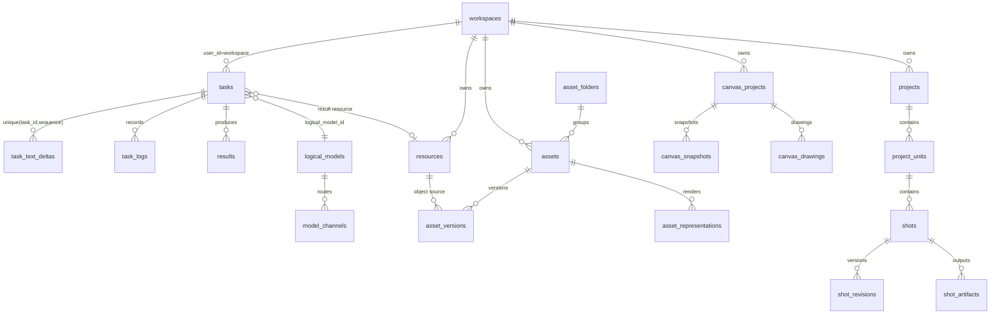

### 4.3 关键表结构（现状事实，源：`backend/internal/model/`）

#### tasks（生成任务，models_task.go:5-67）

| 字段 | 类型 | 说明 |
| --- | --- | --- |
| id | TEXT(36) PK | 任务 ID |
| user_id / project_id | TEXT | 归属（单用户模式=workspace ID）/ 项目 |
| client_operation_id | TEXT | 前端幂等键 |
| status / stage / progress | TEXT/TEXT/INT | queued/running/succeeded/failed/cancelled/text_replay |
| type / provider / model | TEXT | 任务类型与上游 |
| logical_model_id / revision_id / route_id / channel_model_id | TEXT | 模型路由四元组 |
| route_run | INT | 仅用户重试 +1 |
| provider_request_id / provider_cancel_* | TEXT | 上游请求/取消对账 |
| poll_stage / next_poll_at | TEXT/DATETIME | 轮询阶段与下次到期时间 |
| lease_owner / lease_expires_at | TEXT/DATETIME | worker 租约（45s） |
| input_json | BLOB | **加密**输入 |
| result_json / text_draft | TEXT | 结果/文本草稿 |
| failure_diagnostics | JSON | 失败诊断 |
| recovery_outcome | TEXT | no_result/unrecoverable（v26） |
| beef_usage_state / beef_billing_state / beef_reconcile_deadline / image_job_id | TEXT/DATETIME | 结算对账（v27） |
| attempts | INT | 领取次数 |

**索引**：`idx_tasks_user_client_op` UNIQUE(user_id, client_operation_id)（幂等去重）；`idx_tasks_claim`（领取扫描：status+lease+next_poll_at）；`idx_tasks_provider_cancel`（取消对账）；`idx_tasks_user_created`、`idx_tasks_user_project_created`、`idx_tasks_status_created`（列表页）。

#### task_text_deltas / task_logs / results

- `task_text_deltas`（models_task.go:133）：UNIQUE(task_id, sequence) + `expires_at` 索引；SSE 游标即 sequence；保留期成功 24h / 草稿 7d，每小时清理（`textreplay/types.go:14-22`）。
- `task_logs`（:144）：任务执行日志（运维排障）。
- `results`（:157）：生成产物持久行（与 resources 关联）。

#### resources（对象资源，models_project.go:20）

`object_key`、`provider/bucket`（遗留字段）、`playback_status/playback_object_key`（ffmpeg H.264 播放副本）、UNIQUE(user_id, upload_key)（分片上传幂等）；配套 `resource_deletion_jobs`（租约 + next_attempt_at，删除异步对账）。

#### assets 族（models_project.go:72-157）

`assets` / `asset_versions` / `asset_representations` / `asset_folders`：素材主记录、版本、多表示（缩略图/转码）、文件夹树。

#### 短剧工作流族（models_project.go:185-358）

`projects` / `project_units` / `shots` / `shot_revisions` / `shot_artifacts` / `workflow_template_versions` / `workflow_instances` / `workflow_step_instances` / `creation_runs` / `creation_submissions`。

#### canvas 族（models_project.go:374+）

`canvas_projects`（`payload_json` 大 JSON + `revision` **乐观锁**）、`canvas_snapshots`、`canvas_drawings`、`canvas_workflows/runs/revisions`。

#### 平台与配置

`workspaces`（单行本地工作区）、`system_settings`（KV，存 runtime_policy）、`model_channels`（APIKey `json:"-"` 不出响应）、`logical_models/revisions/routes/route_attempts`、`image_submissions`（加密回执）、`agent_op_records`（操作幂等）、`assistant_turns/continuations`、`user_daily_upload_usage/user_upload_reservations`（配额）、`local_schema_migrations`（账本 v28）。

### 4.4 索引设计原则与目标态增量

现状原则（保持）：

1. **幂等唯一索引**兜底并发重放：tasks(user_id, client_operation_id)、resources(user_id, upload_key)、task_text_deltas(task_id, sequence)。
2. **租约扫描索引**覆盖领取 SQL：`queued OR (running AND 租约过期)` 且 `next_poll_at` 到期（repository.go:261 条件更新，attempts+1）。
3. **列表页复合索引**以 user_id 前缀 + created_at 排序，避免全表扫。
4. 大 JSON（canvas payload、input_json）不建索引，按主键整取；前端 IndexedDB 承担离线查询。

迁移 PostgreSQL 时的增量设计：

| 表 | 增量 | 理由 |
| --- | --- | --- |
| tasks | 分区（按月，created_at）；`status, next_poll_at` 部分索引 WHERE status IN ('queued','running') | 领取扫描只关心活跃任务，历史分区冷存 |
| task_text_deltas | 按 expires_at 的清理任务改 `DELETE ... LIMIT` 分批 | 避免长事务锁 |
| canvas_projects | payload_json → JSONB + GIN（可选，仅当需要服务端检索） | 默认仍整取，不提前优化 |
| 全局 | 外键约束显式化（SQLite `_foreign_keys=on` 已有）；序列/UUID 保持 TEXT(36) 兼容 | 双跑期 schema 对齐 |

### 4.5 数据生命周期

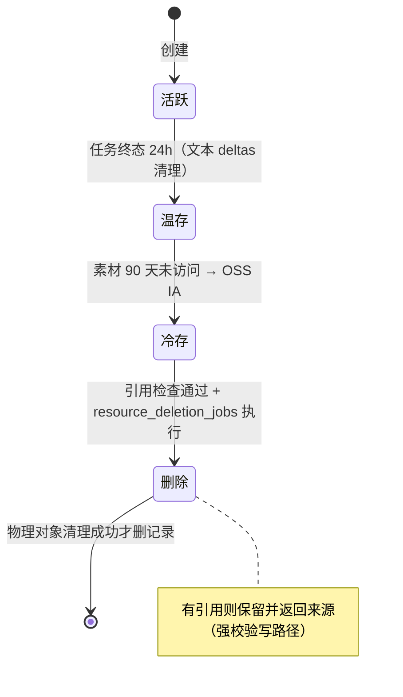

### 4.6 容量预估

**假设（上线 6 个月目标，菲/泰合计）**：注册用户 10,000；DAU 1,000；人均生成任务 20/日；任务构成 70% 图片（~2MB）/ 25% 视频（~20MB）/ 5% 音频文本（~1MB）；峰值系数 5（晚间 19:00–23:00 ICT/PHT）；素材 90 天生命周期。

| 维度 | 计算 | 结果 |
| --- | --- | --- |
| 任务行增长 | 1,000 × 20 | **20,000 行/日**，60 万/月，720 万/年 |
| tasks 表体积 | 行均 ~3KB（含加密 input/result JSON） | ~60MB/日 → **~21GB/年**（含索引 ×1.5 ≈ 32GB） |
| SSE 并发 | DAU 在线率 20% × 订阅率 50% × 峰值 5 | **~500 并发连接**（750ms 轮询 ≈ 667 读/s） |
| 任务创建 QPS | 20,000/86,400 × 5 | 均值 0.23/s，**峰值 ~1.2/s**（限流默认 30/min/用户足够） |
| worker 写 QPS | 并发 running ~200（视频 30s 轮询 + 5s 取回） | **~10–15 写/s**（SQLite 单连接可承受，但与 SSE 读竞争 → B1） |
| 对象存储日增 | 20,000 × (0.7×2 + 0.25×20 + 0.05×1) MB | **~129GB/日** |
| OSS 稳态容量 | 129GB × 90 天 × 1.3（版本/播放副本） | **~15TB**（IA 层占 60%+） |
| CDN 流量 | DAU 1,000 × 50MB 浏览/日 | ~50GB/日 → **1.5TB/月** |
| RDS 规格（目标态） | 32GB 数据 + 700 TPS 峰值读写混合 | **pg.x2.medium.2c（2C8G）起，推荐 4C16G**，存储 ESSD 100GB 起 |
| SQLite PV（过渡态） | DB 32GB/年 + 备份 30 天 + 本地媒体缓存 | **ESSD PL1 200GB**（媒体尽快外置 OSS） |
| ACK 节点（过渡态） | backend 4C8G ×1 + web 2C4G ×2 + auth-gateway 2C4G ×2 + 系统组件 | **3 × ecs.g7.xlarge（4C16G）跨 2 AZ** |
| ACK 节点（目标态） | backend 4C8G ×3（HPA 3–8）+ web ×3 + gateway ×2 | **4–6 × ecs.g7.xlarge，Cluster Autoscaler** |

> 结论：业务写入量很小（峰值 < 20 TPS），**瓶颈不在吞吐而在单点可用性与 SSE 读放大**；存储增长主要在 OSS，成本可控（15TB × 低频单价）。

---

## 5. 核心业务时序图

### 5.1 生成任务：创建 → 领取 → 上游 → 取回（现状机制）

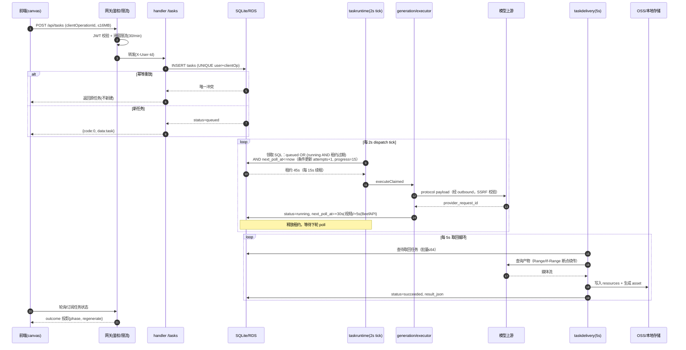

要点：重启不取消 running 任务，凭 `ResumedProviderRequestID` 续查；`/recover` 结构上不新建上游任务；重试仅限 failed/cancelled（审核失败/submission_unknown 禁止，`task/lifecycle.go:27`）。

### 5.2 文本任务 SSE：游标续传

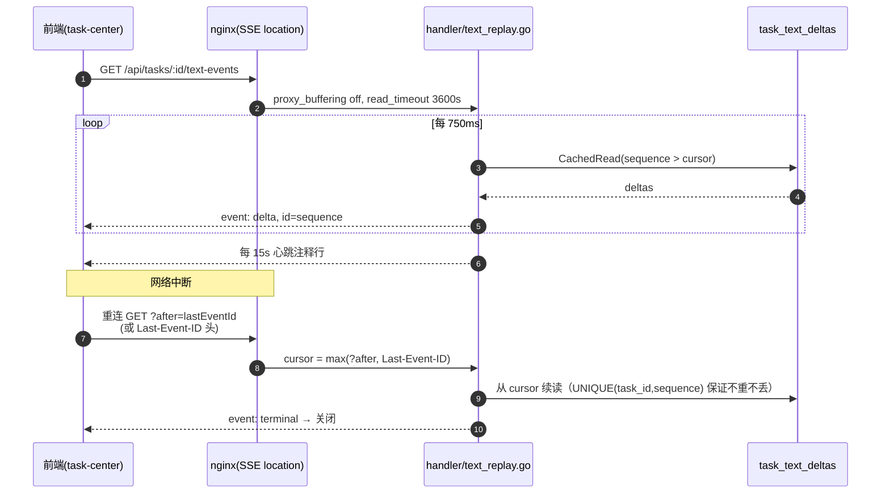

### 5.3 素材上传（分片）与引用安全删除

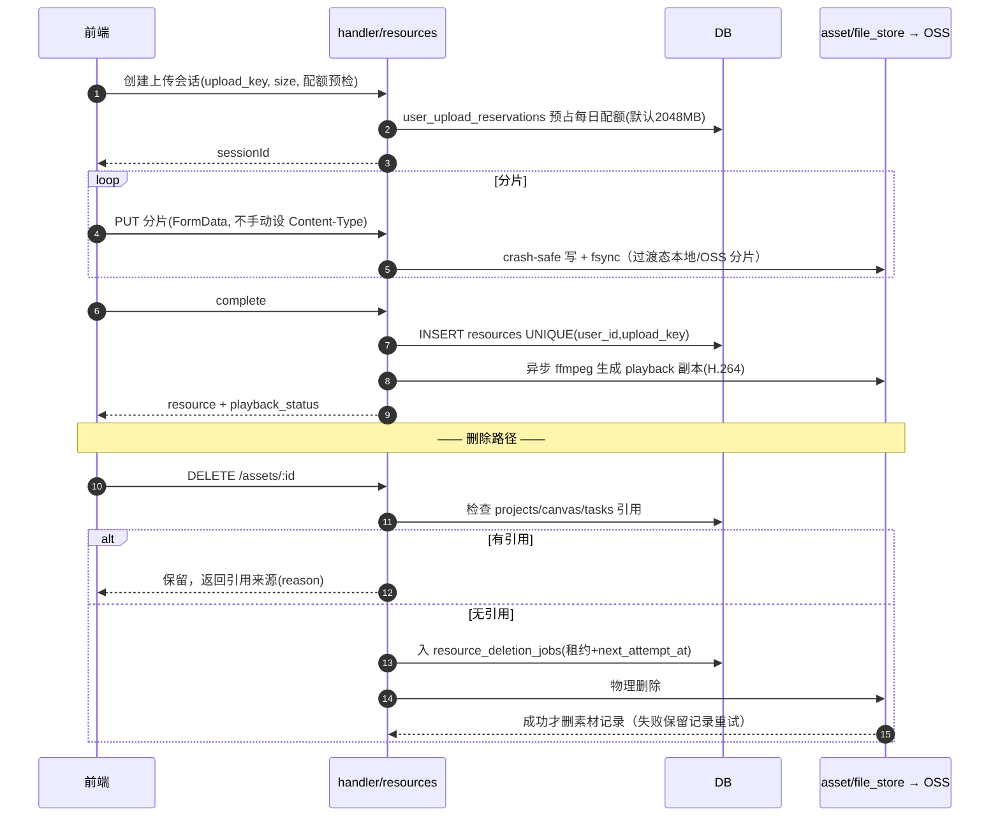

### 5.4 画布保存：乐观锁 + 本地降级

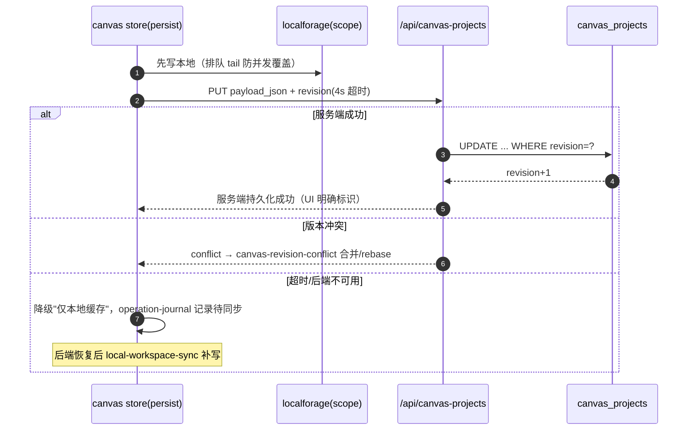

---

## 6. 日志、监控、限流、灰度与回滚

### 6.1 能力矩阵（现状 → 目标）

| 能力 | 现状（证据） | 云上目标 |
| --- | --- | --- |
| 日志 | 标准库 log + gin.LoggerWithFormatter → stdout（runtime.go:205）；任务级 task_logs 表；写操作 span（SupportTracingMiddleware，X-Canvas-Trace-ID/X-Request-ID 贯穿） | iLogtail DaemonSet 采集 stdout → SLS（结构化 JSON 改造）；Trace-ID 全链路检索；敏感字段（密钥/Cookie/签名 URL）禁入日志 |
| 指标 | **无 /metrics**（C4）；健康端点 /api/health/live\|startup\|ready（ready 校验 DB SELECT 1 + schema 版本 + runtime + draining） | 补 prometheus /metrics（任务队列深度、租约续期失败、SSE 连接数、上游熔断态、DB 等待）；ARMS Prometheus + Grafana |
| 限流 | 进程内滑窗协调器（security.go:137，Retry-After），任务创建默认 30/min；渠道熔断 5 次失败/60s（CANVAS_CHANNEL_CIRCUIT_*） | 三层：WAF CC → ALB/Ingress QPS → 应用滑窗（目标态 Tair 集中计数）；配额显式配置（C10） |
| 灰度 | 无（桌面端有 R2 stage/activate 不可变发布可借鉴） | web/auth-gateway：Argo Rollouts 金丝雀（5%→25%→100%）；backend：单副本约束下蓝绿/低峰 Recreate（第 6.4） |
| 回滚 | 迁移账本不可改写（C7）；破坏性迁移前 VACUUM INTO 备份 | 镜像 digest 回滚（ArgoCD rollback）；DB 只允许 expand-contract，contract 前必须备份 + 观察期 |
| 备份 | 仅迁移前备份 | 每日 SQLite 在线备份/OSS（30 天）+ ESSD 快照；RDS PITR 7 天 |

### 6.2 日志与监控链路时序

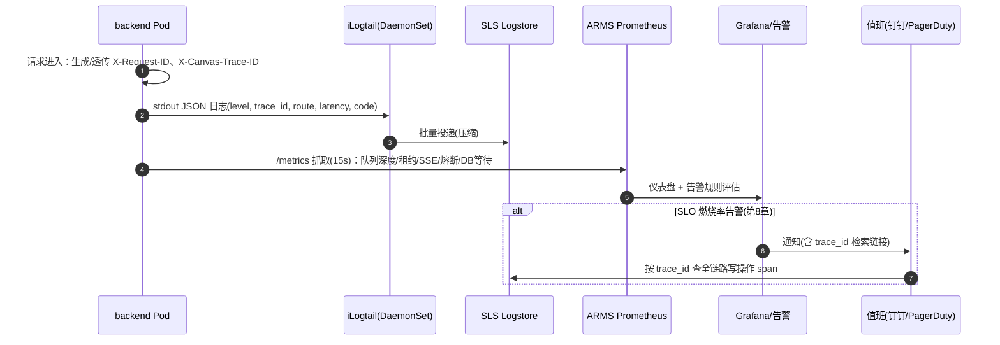

告警规则（最小集）：

| 告警 | 表达式（语义） | 级别 |
| --- | --- | --- |
| 可用性燃烧 | 5xx 比例 1h 窗口 > 14.4× 错误预算消耗率 | P1（页呼） |
| ready 探针失败 | kube_pod_status_ready false > 2min | P1 |
| 任务积压 | queued 且 next_poll_at 过期 > 50 且持续 5min | P2 |
| 租约异常 | lease 续期失败率 > 5% | P2 |
| 渠道熔断 | circuit open 持续 > 10min | P2 |
| SSE 断连率 | 重连率 > 20%/5min | P3 |
| 磁盘/PV | 使用率 > 80% | P2 |

### 6.3 限流实现时序（三层）

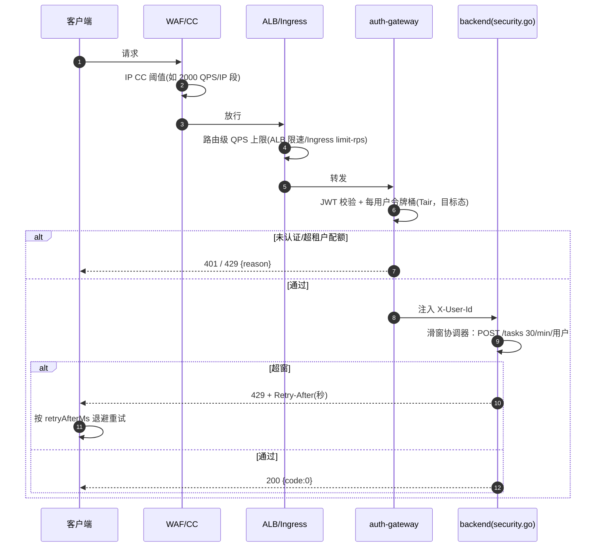

### 6.4 灰度发布时序（web 金丝雀 + backend 受控切换）

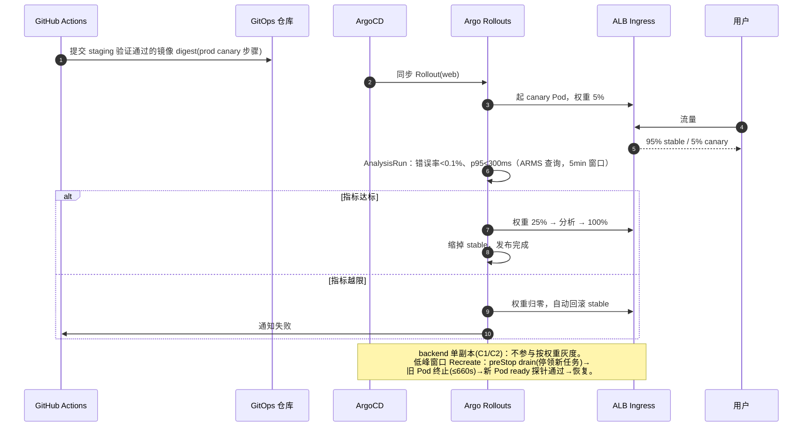

### 6.5 回滚时序（含数据库纪律）

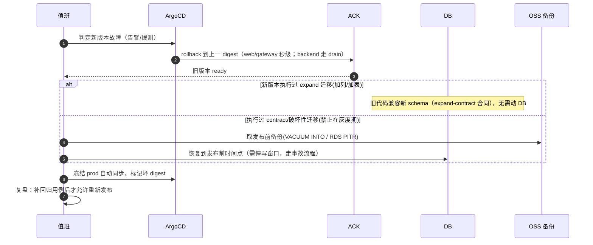

**迁移纪律（C7）**：账本 v28 不可改写；发布只允许 expand（加列/加表/加索引）；contract（删列/改类型）必须独立发布、先备份、观察期 ≥ 7 天；任何回滚不得依赖"schema 降级"。

---

## 7. 部署方案（ACK + Docker Compose）

### 7.1 区域与网络设计（菲律宾/泰国客户）

| 决策 | 选择 | 理由 |
| --- | --- | --- |
| 主区域 | **ap-southeast-1（新加坡）** | 东南亚枢纽，ACK/ALB/RDS/DCDN 产品最全；至马尼拉 ~35ms、曼谷 ~25ms 骨干延迟 |
| 边缘接入 | **GA 全球加速（马尼拉/曼谷 POP）+ DCDN** | 菲/泰本地 ISP 跨境公网抖动大，GA 就近进入阿里云骨干；静态资源 DCDN 缓存 |
| 备选主区域 | ap-southeast-6（马尼拉）/ ap-southeast-7（曼谷） | 若用户分布单一国家占绝对多数，可单国部署 + 新加坡灾备（Phase 3 双区域） |
| 可用区 | 新加坡 AZ-A + AZ-B（≥2 AZ） | ALB/RDS/ACK 节点跨 AZ，单 AZ 故障不全站 |
| 出网 | NAT 网关 + 固定 EIP（多 AZ） | 模型上游 IP 白名单；`CANVAS_ALLOW_PRIVATE_UPSTREAMS=false`（生产收紧），仅 `CANVAS_ALLOWED_PRIVATE_UPSTREAM_HOSTS` 精确放行内网模型 |
| 合规 | 菲/泰个人数据：DPA(PH)/PDPA(TH) | 日志脱敏、密钥 KMS、数据保留策略（4.5 节）、用户删除请求走引用检查删除链 |

### 7.2 ACK 集群拓扑

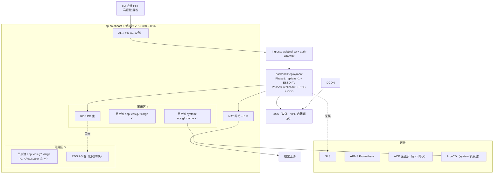

集群基线：**ACK Pro 托管版**（控制面 SLA 99.95%，免运维 Master）；Terway 网络插件；节点池分离 system（ArgoCD/监控）与 app（业务）；app 池开启 Cluster Autoscaler；Pod 反亲和 + topologySpreadConstraints 跨 AZ。

### 7.3 关键 K8s 清单（deploy/k8s/base，节选）

```yaml
# backend-deployment.yaml（Phase 1 过渡态：单副本 + ESSD）
apiVersion: apps/v1
kind: Deployment
metadata: { name: beeftv-backend }
spec:
  replicas: 1                      # C1/C2：状态外置完成前禁止 >1
  strategy: { type: Recreate }     # RWO PV 不可双挂
  template:
    spec:
      terminationGracePeriodSeconds: 660   # 对齐 C6（10m drain）
      containers:
      - name: backend
        image: acree-registry.ap-southeast-1.cr.aliyuncs.com/beeftv/backend@sha256:PINNED
        ports: [{ containerPort: 8080 }]
        env:
        - { name: CANVAS_BACKEND_ADDR, value: ":8080" }
        - { name: CANVAS_BACKEND_DATA_DIR, value: /data }
        - { name: CANVAS_CORS_ORIGINS, value: "https://app.beef.example" }
        - { name: CANVAS_ALLOW_PRIVATE_UPSTREAMS, value: "false" }
        - { name: CANVAS_WORKER_CONCURRENCY, value: "8" }      # 显式收紧（C10）
        - { name: CANVAS_CHANNEL_CONCURRENCY, value: "4" }
        - { name: CANVAS_SHUTDOWN_TIMEOUT, value: "10m" }
        - { name: GIN_MODE, value: release }
        envFrom:
        - secretRef: { name: beeftv-secrets }   # KMS 凭据管家同步，禁明文 ConfigMap
        startupProbe:
          httpGet: { path: /api/health/startup, port: 8080 }
          failureThreshold: 30
          periodSeconds: 5
        readinessProbe:
          httpGet: { path: /api/health/ready, port: 8080 }
          periodSeconds: 5
        readinessGates: []          # ready 已含 DB/schema/draining 校验
        livenessProbe:
          httpGet: { path: /api/health/live, port: 8080 }
          periodSeconds: 10
        lifecycle:
          preStop:
            exec: { command: ["/bin/sh","-c","sleep 5"] }  # 等 ALB 摘流；drain 由 SIGTERM 触发
        resources:
          requests: { cpu: "2", memory: 4Gi }
          limits: { cpu: "4", memory: 8Gi }
        volumeMounts: [{ name: data, mountPath: /data }]
      volumes:
      - name: data
        persistentVolumeClaim: { claimName: beeftv-data }   # ESSD PL1 200Gi RWO
---
# ingress-sse.yaml（ALB Ingress：SSE 关键注解）
apiVersion: networking.k8s.io/v1
kind: Ingress
metadata:
  name: beeftv
  annotations:
    alb.ingress.kubernetes.io/listen-ports: '[{"HTTPS":443}]'
    alb.ingress.kubernetes.io/backend-keepalive: "true"
    # 空闲超时覆盖 SSE 心跳间隔（15s）与长任务
    alb.ingress.kubernetes.io/connection-drain-enabled: "true"
    alb.ingress.kubernetes.io/connection-drain-timeout: "600"
spec:
  ingressClassName: alb
  rules:
  - host: app.beef.example
    http:
      paths:
      - path: /api
        pathType: Prefix
        backend: { service: { name: auth-gateway, port: { number: 80 } } }
      - path: /
        pathType: Prefix
        backend: { service: { name: beeftv-web, port: { number: 3000 } } }
```

> 注：ALB 实例级空闲超时在控制台/AlbConfig 设为 900s；SSE 响应自带 `X-Accel-Buffering: no`，nginx web 层已按路径关缓冲（根 nginx.conf 两条 SSE location），ALB 需验证不缓冲（上线冒烟必测项）。auth-gateway 为新增轻量服务（OIDC/JWT → 注入后端可信身份头），**仅允许集群内访问 backend 8080**（NetworkPolicy），补齐 C3。

### 7.4 单机 Docker Compose 部署（现状即支持）

```bash
# 生产形态：docker-compose.yml（web 3000 唯一公网口，backend 不出网）
docker compose -f docker-compose.yml -f docker-compose.build.yml up -d --build
```

要点（事实）：

- backend：`CANVAS_BACKEND_ADDR=:8080`、数据卷 `backend-data:/data`、`restart: unless-stopped`、`stop_grace_period: 10m`、健康检查 `/api/health/ready`（30s）；web `depends_on: backend condition: service_healthy`。
- nginx（web 容器内）：`client_max_body_size 1024m`；`/assets/` immutable 1y；SSE 两条 location `proxy_buffering off / gzip off / read_timeout 3600s`；SPA fallback 覆盖 `/canvas`、`/projects`、`/assets` 精确路径。
- **公网单机加固清单（C3）**：前置 Caddy/nginx 终结 TLS + Basic/OIDC；`CANVAS_CORS_ORIGINS` 设真实域名；防火墙仅放行 443；`CANVAS_ALLOW_PRIVATE_UPSTREAMS=false`；每日 `sqlite3 .backup` + 异地上传（compose 形态无自动备份，需自建 cron）。
- 开发：`docker-compose.dev.yml`（air 热重载 + bun dev，数据 `.local/project-workbench-debug`，宿主端口仅 127.0.0.1）；本地构建运行：`docker-compose.local.yml`（develop.watch 自动重建）。

### 7.5 监控与灰度在 ACK 的落地

| 项 | 配置 |
| --- | --- |
| 日志 | iLogtail DaemonSet → SLS project `beeftv-prod`（logstore：app-stdout / ingress-access / task-audit），保留 30 天（审计 180 天） |
| 指标 | ARMS Prometheus 托管版；抓取 backend /metrics（待补）+ kube-state-metrics + ALB 云监控集成 |
| 拨测 | ARMS 云拨测：马尼拉/曼谷/新加坡三探针，每 1min `GET /api/health/ready` + 首页 + SSE 建连样本 |
| 灰度 | web/auth-gateway：Argo Rollouts + ALB 权重（ALB Ingress 支持 canary 注解）；backend：低峰 Recreate（见 6.4） |
| 告警 | 6.2 表；P1 → PagerDuty/电话，P2 → 钉钉群 |
| 备份 | CronJob 每日 02:00 ICT：SQLite `.backup` → OSS（30 天版本化）；ESSD 自动快照策略每日；Phase 3 RDS PITR |

---

## 8. SLA 99.95% 达成设计

### 8.1 目标与预算

- **99.95% 月度可用性 = 每月停机预算 21.6 分钟**（30 天 × 24h × 0.05%）；年度 4.38h。
- SLI 定义：`成功请求数 / 有效请求数`，探针来源为马尼拉/曼谷拨测 + ALB 访问日志；5xx、ready 失败、SSE 建连失败计为不可用；**上游模型供应商故障导致的任务失败不计入平台 SLA**（合同需向客户明示，任务本身可恢复/重试）。
- 发布停机计入预算：Phase 1 每次 backend Recreate 空窗 30–90s，**每月最多允许 ~14 次**（留 50% 余量给故障），实际排期每周 ≤ 2 次低峰发布。

### 8.2 分阶段可用性论证

| 阶段 | 形态 | 可用性估算 | 是否达标 | 关键动作 |
| --- | --- | --- | --- | --- |
| **Phase 1（上线即用）** | ACK 单 AZ 冗余节点 + backend 单副本（ESSD PV）+ ALB 双 AZ + 每日备份 | 节点故障：PV 随节点漂移，ESSD 云盘不随节点丢失，Pod 重建 + startup ≈ 2–5min；AZ 故障：PV 不可跨 AZ 挂载 → **AZ 级故障不达标**；月预算内单点故障 1–2 次可吸收 | **~99.9%（不达标，明示）** | 快速重建 runbook；备份恢复演练；拨测 1min |
| **Phase 2（3 个月内）** | backend 主备双 AZ：备 Pod 常备（不挂库，仅镜像预热），主 ready 失败 → 控制器切换 PVC 挂载（ESSD 多挂载/快照秒级克隆）或 NAS 只读兜底页；web/gateway 多副本跨 AZ | 主备切换 60–120s × 月均 1 次 ≈ 2min，远低预算；AZ 故障可切换（云盘跨 AZ 恢复用快照，RTO ~10min 需演练） | **~99.95%（有条件达标）** | 切换控制器（Operator/脚本 + leader 租约）；每月故障演练；静态降级页（DCDN 缓存 + 只读模式） |
| **Phase 3（6 个月内，根治）** | **RDS PostgreSQL 高可用（跨 AZ 主备，自动切换 <30s）+ OSS 媒体 + backend 无状态多副本（3–8，HPA）+ Tair 限流** | 串联：ALB 99.99% × ACK Pro 99.95% × RDS 99.95% × 应用层(多副本) 99.99% ≈ **99.93–99.97%**；应用层多副本消除发布/单点空窗后整体 ≥ 99.95% | **达标（目标态）** | 完成 C1/C2/C3/C4 改造（第 9 章）；双跑验证；SLO 燃烧率告警 |

> 诚实结论：**当前代码形态（SQLite 单连接 + 本地盘 + 单副本）无法原生保证 99.95%**。Phase 1/2 是工程补偿（预算管控 + 主备切换），Phase 3 才是结构性达标。对客户承诺 99.95% 的合同应以 Phase 3 上线为生效点，或按阶段明示不同赔付档位。

### 8.3 错误预算策略

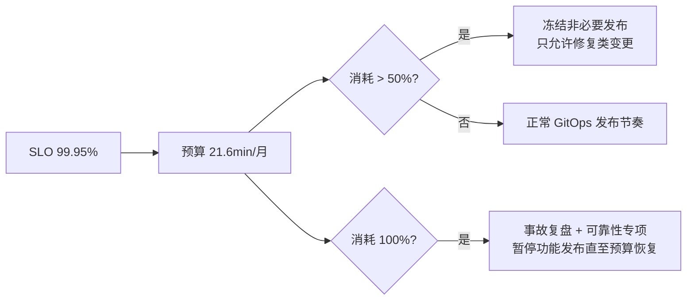

### 8.4 故障场景与 RTO/RPO

| 场景 | 检测 | 处置 | RTO | RPO |
| --- | --- | --- | --- | --- |
| 单 Pod 崩溃 | liveness 10s×3 | 自动重启；任务凭租约过期被重新领取 | <1min | 0（DB 持久） |
| 节点故障 | Node NotReady 40s | Pod 漂移；Phase1 ESSD 随节点重建 | 2–5min | 0 |
| AZ 故障 | 拨测 + ALB 健康 | Phase2 主备切换 / Phase3 自动 | Phase2 ≤15min；Phase3 <1min | Phase2 ≤24h（日备份）→ 快照后 ≤5min；Phase3 ≈0 |
| DB 损坏/误迁移 | ready 探针 schema 校验 | 备份恢复（VACUUM INTO / PITR） | ≤30min（演练值） | ≤24h → PITR 秒级 |
| 发布引入故障 | Rollouts 分析 / 燃烧率告警 | digest 回滚（6.5） | <2min | 0 |
| 区域级灾难 | 人工判定 | Phase3 预案：OSS 跨区复制 + IaC 重建（terraform） | ≤4h | ≤15min（跨区复制延迟） |

---

## 9. 系统不足与改进措施

| # | 不足（现状证据） | 风险 | 改进措施 | 优先级/阶段 |
| --- | --- | --- | --- | --- |
| G1 | server profile 无鉴权（main.go:85），单用户工作区模型 | 公网暴露=任意人可读写/删数据、盗用模型密钥 | **上线阻塞项**：auth-gateway（OIDC/JWT）+ NetworkPolicy 仅网关可达 backend；中期后端原生多用户（workspaces 表已预留 user_id 语义） | P0 / Phase1 |
| G2 | SQLite MaxOpen=1 + 本地盘（C1/C2） | 无法水平扩展，单点故障即全站 | repository 层抽象已存在 → 增加 Postgres 驱动与方言迁移（账本双轨）；媒体切 OSS（referencestorage S3 兼容代码已有，扩展为全量存储后端） | P0 / Phase3 |
| G3 | 无 metrics（C4），日志非结构化 | 故障定位慢，SLO 无法度量 | 补 /metrics（promhttp）；log 换 slog JSON；保留 Trace-ID 贯穿 | P1 / Phase1 |
| G4 | 死变量 CANVAS_LOCAL_MODE / CANVAS_REGISTRATION_ENABLED；local 策略放开并发/配额到 999（C10） | 生产误以为有限流实际裸奔 | 删除死变量或实现读取；生产 RuntimePolicy 显式配置并加启动日志打印生效策略 | P1 / Phase1 |
| G5 | 无周期备份（仅迁移前 VACUUM INTO） | 误删/损坏丢数据 | CronJob 日备 + OSS 版本化 + 季度恢复演练 | P0 / Phase1 |
| G6 | SSE 750ms 轮询读库 | 读放大（500 连接≈667QPS），与写竞争单连接 | 事件通知改 LISTEN/NOTIFY（PG）或内存 pub/sub + 轮询兜底；连接数上限与背压 | P2 / Phase3 |
| G7 | 无压测/无 K8s 清单/无部署文档（C9） | 容量与发布全靠推断 | 落地 loadtest/ 与 deploy/（本文设计）；docs 增 deployment 专题 | P1 / Phase1 |
| G8 | 前端巨型文件（project.tsx 2967 行等）与 4s 超时全局降级 | 维护成本高；弱网下误降级掩盖服务端错误 | 按 AGENTS.md 边界渐进拆分；降级提示区分网络/业务错误（reason 已有） | P2 |
| G9 | agent-host 子进程仅 desktop 自动启动，云形态未定义 | 云上助手功能缺失或失控 | 云形态默认关闭助手；需要时独立 Deployment（Node 镜像）+ 资源限额 + 操作授权审计（agent_op_records 已有幂等） | P2 / Phase2 |
| G10 | 跨境上游访问无固定出口 | 上游白名单/风控不可控 | NAT 固定 EIP；渠道多路由 + 熔断参数按区域调优 | P1 / Phase1 |
| G11 | 迁移账本不可逆（C7） | 回滚受限 | expand-contract 纪律 + 发布前自动备份门禁（CI 检查） | P0 / Phase1 |
| G12 | 单机 compose 无自动 TLS/备份/加固 | 小客户私有化部署裸奔 | 提供 compose.prod 加固模板（Caddy + cron 备份 + 防火墙脚本） | P2 |

---

## 10. GitOps 三环境流水线

### 10.1 仓库与工具链

| 仓库 | 内容 | 权限 |
| --- | --- | --- |
| `BeefTV`（应用源） | 代码 + `.github/workflows`（现有 9 条保留，新增 deploy 相关 job） | 开发 PR + 交叉 review（AGENTS.md 纪律） |
| `beeftv-gitops`（新建） | `envs/{dev,staging,prod}` Kustomize overlay + ArgoCD ApplicationSet + Rollouts 策略 | **只有 CI 机器人与平台负责人可写 prod**；环境晋升走 PR |
| 工具 | GitHub Actions（CI）→ ghcr.io（现有）→ **ACR 企业版 ap-southeast-1**（镜像同步，双架构）→ ArgoCD（ACK system 池）→ Argo Rollouts（金丝雀） | 镜像一律 **digest 固定**，禁 latest 上 prod |

### 10.2 环境定义

| 环境 | 集群/命名空间 | 数据 | 发布方式 | 用途 |
| --- | --- | --- | --- | --- |
| dev | ACK `beeftv-dev` ns（可与 staging 同集群不同 ns，独立节点池污点） | 独立 RDS 小规格/SQLite + 合成数据 | push main → 自动同步 | 联调、契约测试 |
| staging | ACK `beeftv-staging` ns | 脱敏副本 + 独立 OSS bucket | dev 验证通过后 PR 晋升（自动合并需 1 审批） | 压测（3.4）、e2e 门禁、发布演练 |
| prod | ACK `beeftv-prod`（独立集群，Pro 版） | 生产 RDS/OSS | staging 门禁全绿 → 人工审批 PR → Rollouts 金丝雀 | 菲/泰用户 |

### 10.3 流水线全景

```mermaid
flowchart LR
    subgraph ci["CI：GitHub Actions（应用仓库）"]
        PR["PR：quality.yml<br/>Go test / bun lint+build / director-e2e<br/>+ 交叉 review"] --> MAIN["merge main"]
        MAIN --> PUB["publish-images.yml<br/>ghcr 双架构 + sha-tag"]
        PUB --> SYNC["镜像同步 ACR<br/>（skopeo copy，digest 不变）"]
        SYNC --> UPD["机器人提交 gitops：<br/>envs/dev digest 更新"]
    end
    subgraph cd["CD：ArgoCD（GitOps 仓库为唯一事实源）"]
        UPD --> DEV["dev Application<br/>auto-sync + selfHeal"]
        DEV --> DT["dev 冒烟：探针/SSE/任务闭环"]
        DT -->|"通过"| PRS["晋升 PR：staging digest<br/>（1 审批）"]
        PRS --> STG["staging Application<br/>auto-sync"]
        STG --> GATE["门禁：k6 压测阈值 + e2e<br/>+ 迁移 expand 检查 + 备份确认"]
        GATE -->|"全绿"| PRP["晋升 PR：prod digest<br/>（平台负责人审批）"]
        PRP --> PROD["prod Application<br/>手动 sync 窗口"]
        PROD --> CAN["Rollouts 金丝雀<br/>web/gateway 5→25→100%<br/>backend 低峰 Recreate"]
        CAN -->|"分析失败"| RB["自动回滚 stable digest"]
        CAN -->|"成功"| DONE["打 Git tag：release-prod-<ver><br/>记录 CHANGELOG"]
    end
```

### 10.4 晋升与回滚时序

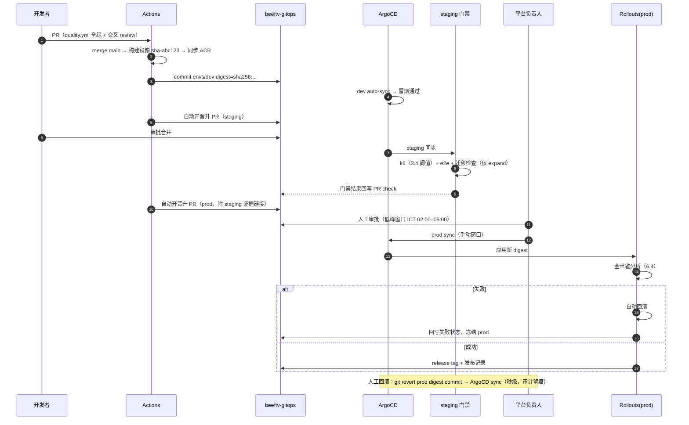

### 10.5 GitOps 仓库结构与关键配置

```text
beeftv-gitops/
├── apps/
│   ├── backend/     # Deployment/Service/PVC/Secret(ExternalSecret→KMS)
│   ├── web/         # Rollout(金丝雀)/Service/ConfigMap(nginx)
│   ├── auth-gateway/
│   └── observability/ # iLogtail/ARMS 接入/告警规则
├── envs/
│   ├── dev/         # kustomization：replicas=1、资源减半、合成数据 Secret
│   ├── staging/     # 压测 Job 模板、门禁配置
│   └── prod/        # replicas、HPA、PDB、ALB 注解、Rollouts 分析模板
├── argocd/
│   ├── applicationset.yaml   # 三环境 Application（prod: syncPolicy 手动）
│   └── project.yaml          # AppProject：prod 仅允许本仓库路径+ACR 镜像源
└── CODEOWNERS       # envs/prod → 平台负责人
```

```yaml
# argocd/applicationset.yaml（节选）
apiVersion: argoproj.io/v1alpha1
kind: ApplicationSet
spec:
  generators:
  - list:
      elements:
      - { env: dev,    autoSync: "true"  }
      - { env: staging, autoSync: "true" }
      - { env: prod,   autoSync: "false" }   # prod 手动窗口
  template:
    metadata: { name: "beeftv-{{env}}" }
    spec:
      project: beeftv
      source:
        repoURL: https://github.com/<org>/beeftv-gitops
        path: "envs/{{env}}"
      destination: { server: https://kubernetes.default.svc, namespace: "beeftv-{{env}}" }
      syncPolicy:
        retry: { limit: 3, backoff: { duration: 30s, maxDuration: 5m } }
        syncOptions: [CreateNamespace=true, PruneLast=true]
```

纪律：

1. **镜像 digest 固定**，CI 是唯一写入者；任何人不得 kubectl 直改 prod（ArgoCD selfHeal 会纠正，审计告警）。
2. prod 变更必须携带 staging 门禁证据（压测报告、e2e 录屏、迁移检查），符合 AGENTS.md"通知只写已验证事实"。
3. 桌面发布线（release-desktop.yml 的 R2 stage/activate 不可变发布）与云发布线并行，互不阻塞；VERSION/CHANGELOG 一致性校验沿用现有 tag 门禁。
4. Secret 不入 Git：ExternalSecrets Operator 对接 KMS 凭据管家；GitOps 仓库只存 Secret 引用。

---

## 11. 附录：环境变量与容量参数速查

### 11.1 后端生产环境变量（事实来源：cmd/server + compose + platform）

| 变量 | 默认 | 生产建议 |
| --- | --- | --- |
| CANVAS_BACKEND_ADDR | 127.0.0.1:8080 | `:8080`（容器内，仅 ClusterIP 暴露） |
| CANVAS_BACKEND_DATA_DIR | data | `/data`（PV 挂载点） |
| CANVAS_AUTO_MIGRATE | true | true（账本 expand-only 纪律下） |
| CANVAS_DATABASE_DRIVER | sqlite | Phase1 sqlite → Phase3 postgres（需 G2 改造） |
| CANVAS_SHUTDOWN_TIMEOUT | 10m | 10m（对齐 terminationGracePeriodSeconds=660） |
| CANVAS_CORS_ORIGINS | localhost:3000 | 生产域名精确白名单 |
| CANVAS_ALLOW_PRIVATE_UPSTREAMS | true | **false** |
| CANVAS_ALLOWED_PRIVATE_UPSTREAM_HOSTS | 空 | 仅内网模型上游精确放行 |
| CANVAS_WORKER_CONCURRENCY / CANVAS_CHANNEL_CONCURRENCY | 3 / 3 | 8 / 4（按压测调整，勿依赖 local 999） |
| CANVAS_CHANNEL_CIRCUIT_FAILURES / _SECONDS | 5 / 60 | 按区域上游质量调优 |
| CANVAS_PUBLIC_BASE_URL | 空 | 公网 HTTPS 域名（签名 URL/回调用） |
| CANVAS_FFMPEG_PATH / FFPROBE_PATH | PATH | 镜像内置路径（播放副本转码） |
| ENABLE_PROVIDER_PLUGINS | false | 按需（协议插件包已随镜像构建） |
| GIN_MODE | — | release |
| ⚠️ CANVAS_LOCAL_MODE / CANVAS_REGISTRATION_ENABLED | compose 传但代码不读 | 清理（G4） |

### 11.2 关键运行时参数（现状常量）

| 参数 | 值 | 位置 |
| --- | --- | --- |
| dispatch tick / 租约 / 续租 | 2s / 45s / 15s | taskruntime/runtime.go |
| 视频轮询 / BeefAPI 轮询 / 取回循环 / 取消对账 | 30s / 5s / 5s / 5s | app/video_polling.go:18-20、task_delivery.go:30 |
| 执行超时（默认策略） | 图/文/音 8m、视频 60m、分镜 20m | platform/runtime_policy.go |
| SSE 轮询 / 心跳 | 750ms / 15s | handler/text_replay.go |
| 文本 deltas 保留 | 成功 24h / 草稿 7d，每小时清理 | textreplay/types.go:14-22 |
| 任务 body 上限 / 单文件默认配额 / 每日上传 | 16MB / 50MB / 2048MB | handler/routes.go、platform |
| 取回批量 / 出网重定向 | ≤64 / ≤5 | taskdelivery、outbound |
| SQLite DSN | busy_timeout=5000, WAL, foreign_keys=on, synchronous=NORMAL, MaxOpen=1 | database/database.go:30,46 |

### 11.3 参考文件索引

- 架构合同：`docs/architecture/generation-task-state.md`、`docs/local-first-architecture.md`
- API/DB 文档：`docs/content/docs/backend/http-api.mdx`、`backend-database.mdx`、`code-map.mdx`
- 部署事实：根 `Dockerfile`、`backend/Dockerfile`、`nginx.conf`、`docker-compose*.yml`
- CI 事实：`.github/workflows/quality.yml`、`publish-images.yml`、`release-desktop.yml`
- 工作约定：`AGENTS.md`（分层/验证/交付纪律，本文所有改造须遵守）

---

*本文档中"现状事实"部分均经代码检索核对（分支 main，f4dd5b5d）；"目标设计"部分为待实施方案，落地状态以第 9 章改进路线与 GitOps 仓库实际提交为准。*